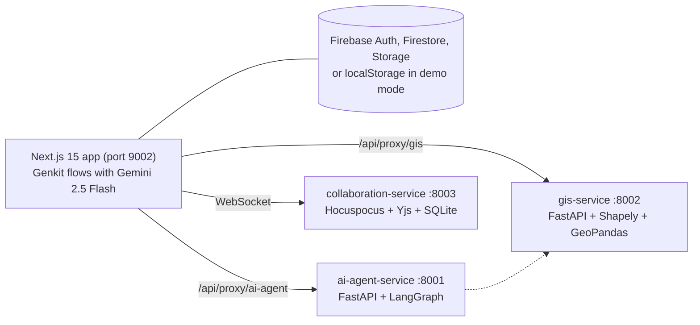

# EcoClear Workflow

A role-based web portal that digitises India's Environmental Clearance (EC) process, from the first application filed by a project proponent to the signed and finalised Minutes of Meeting.

It was built as a hackathon submission for the Chhattisgarh Environment Conservation Board (CECB) problem statement "Role Based Environmental Clearance System" (PARIVESH 3.0 context). The app pairs a Next.js and Firebase frontend with optional Python microservices for AI scrutiny and GIS analysis, and a WebSocket service for real-time collaborative editing. AI is used as a copilot: every generated summary, gist and draft lands in an editable form that an officer reviews before anything is saved.

## Features by role

**Project proponent**
- Multi-step application form for Category A, B1 and B2 projects, with a site location picker on a Leaflet map and a district selector
- Sector and category based document checklist shown while filling the form
- Aadhaar eKYC step with a demo mode and a live mode that sends a real SMS OTP through Firebase Phone Auth
- UPI fee payment with an NPCI-style deep link and QR code (A: ₹50,000, B1: ₹25,000, B2: ₹15,000)
- Document upload with a SHA-256 hash computed at upload and checked later for tampering
- Status timeline across all workflow stages, plus a public `/status` page that needs no login

**Scrutiny team**
- Scrutiny pool filtered by role and by assigned sector and district (RBAC plus ABAC)
- AI document scrutiny and a sector-specific regulatory compliance check with severity and regulation references
- GIS proximity check against Chhattisgarh eco-sensitive zones and a Sentinel-2 NDVI view (mock data)
- Raise EDS (Essential Document Sought) comments or refer the application to a meeting after reviewing an AI-drafted gist

**MoM team**
- Meeting desk filtered by sector and district
- Collaborative Minutes of Meeting editor (TipTap and Yjs) with live multi-user sync
- AI draft of the minutes into a structured form (decision, summary, conditions) that the officer edits
- Template variables (`{{variable}}`), eSign with an OTP mock, and export to PDF or DOCX

**Admin**
- User management with role and ABAC attribute assignment
- Industry sector management (14 sectors seeded) and MoM template management
- Analytics dashboard: SLA compliance rate, sector distribution, monthly trend and per-stage bottlenecks

**Everyone signed in**
- SLA badges (on track, due soon, overdue) on application lists
- RegBot, a multi-turn chat assistant for CECB and EC regulation questions
- Light and dark themes

## Architecture



- **Dual-mode store.** When the Firebase variables are set, data lives in Firestore with real-time `onSnapshot` listeners. Without them the app runs on localStorage, so it can be demoed offline.
- **Optional services.** The Next.js app proxies calls to the Python services through its own API routes and still works when they are not running.
- **Collaboration fallback.** The MoM editor connects to the Hocuspocus server when a WebSocket URL is available, otherwise it syncs peer to peer over WebRTC, and it always keeps a local IndexedDB copy.

### AI scrutiny pipeline (LangGraph)

`services/ai-agent-service` runs a graph of five nodes: ingestion, regulatory analyzer, validation and draft, reflector, and an EDS generator that only runs when the reflector decides an EDS is required. It returns `overall_risk` (LOW, MEDIUM, HIGH or CRITICAL), `compliance_score`, `compliance_issues`, `missing_documents`, `recommendations` and `reflector_quality_score`.

Endpoints: `POST /api/scrutiny/analyze`, `POST /api/eds/generate`, `POST /api/compliance/check`, `GET /health`.

### GIS service

`services/gis-service` checks a project site against 8 Chhattisgarh eco-sensitive zones (national parks, tiger reserves, wildlife sanctuaries, a reserve forest and the Mahanadi corridor) using category buffers of 10 km (A), 5 km (B1) and 2 km (B2). Endpoints: `/api/gis/proximity`, `/api/gis/buffer`, `/api/gis/intersection` and `/api/gis/satellite`. The satellite endpoint returns mock Sentinel-2 NDVI data.

## Workflow

| Stage | Actor | Key actions |
|---|---|---|
| Draft | Proponent | Fill the form, attach documents |
| Submitted | Proponent | Pay the application fee (UPI) |
| UnderScrutiny | Scrutiny | AI analysis, EDS comments |
| EDS | Proponent | Respond to EDS queries, then resubmit |
| Referred | MoM team | Schedule the meeting, edit the gist |
| MoMGenerated | MoM team | Collaborative MoM drafting, eSign |
| Finalized | MoM team | Export PDF or DOCX |

Allowed transitions are enforced in `src/lib/types.ts`: Draft to Submitted, Submitted to UnderScrutiny, UnderScrutiny to EDS or Referred, EDS back to Submitted, Referred to MoMGenerated, and MoMGenerated to Finalized.

## Tech stack

| Layer | Technology |
|---|---|
| Frontend | Next.js 15 (App Router, Turbopack), React 19, TypeScript, Tailwind CSS, shadcn/ui, Recharts |
| Auth, data, files | Firebase Auth, Firestore, Firebase Storage |
| AI in the app | Google Genkit with Gemini 2.5 Flash |
| AI service | Python, FastAPI, LangGraph, `langchain-google-genai`, optional LangSmith tracing |
| GIS | Leaflet on the client; FastAPI, Shapely, GeoPandas, pyproj in the service |
| Collaboration | Hocuspocus, Yjs, TipTap, y-webrtc, y-indexeddb, SQLite |
| Exports | jsPDF, docx |
| Infra | Docker Compose, Vercel config (`vercel.json`), Firebase rules and indexes |

## Getting started

### Prerequisites

- Node.js 20 or newer (the Dockerfile and seed script use Node 22)
- Python 3.11 or newer for the microservices (their Docker images use 3.12)
- Docker and Docker Compose, if you want to run the services in containers
- A Firebase project with Auth, Firestore and Storage enabled (optional, see demo mode below)

### 1. Install and configure

```bash
git clone https://github.com/Aqwerty321/ecoclearworkflow_hackthon.git
cd ecoclearworkflow_hackthon
npm install --legacy-peer-deps
cp .env.local.example .env.local
```

Fill in `.env.local`. The variables are:

- Firebase: `NEXT_PUBLIC_FIREBASE_API_KEY`, `NEXT_PUBLIC_FIREBASE_AUTH_DOMAIN`, `NEXT_PUBLIC_FIREBASE_PROJECT_ID`, `NEXT_PUBLIC_FIREBASE_STORAGE_BUCKET`, `NEXT_PUBLIC_FIREBASE_MESSAGING_SENDER_ID`, `NEXT_PUBLIC_FIREBASE_APP_ID`, `NEXT_PUBLIC_FIREBASE_MEASUREMENT_ID`
- Gemini for Genkit flows: `GOOGLE_GENAI_API_KEY`
- India Stack mock switch and UPI payee: `NEXT_PUBLIC_INDIA_STACK_MOCK`, `NEXT_PUBLIC_CECB_UPI_VPA`
- Microservices (optional): `AI_AGENT_SERVICE_URL`, `GIS_SERVICE_URL`, `COLLABORATION_SERVICE_URL`
- Collaborative editor (optional): `NEXT_PUBLIC_COLLAB_WS_URL`, or `NEXT_PUBLIC_COLLAB_DISCOVERY_URL` when using the tunnel setup below
- LangSmith (optional): `LANGCHAIN_TRACING_V2`, `LANGCHAIN_PROJECT`, `LANGCHAIN_API_KEY`

If you leave the Firebase variables empty, the app runs in demo mode on localStorage.

### 2. Firebase rules and seed data (optional)

```bash
npm install -g firebase-tools
firebase login
firebase deploy --only firestore:rules,firestore:indexes,storage
node scripts/seed-firestore.mjs
```

The seeder reads the API key from `.env.local`, is safe to re-run, and creates the demo users, the 14 sectors and four demo applications. Note that it currently targets the project ID set in the script and in `.firebaserc`, so change both to point at your own Firebase project.

### 3. Run the web app

```bash
npm run dev          # http://localhost:9002
npm run genkit:dev   # optional Genkit developer UI
npm run typecheck
npm run build
```

### 4. Run the microservices (optional)

With Docker Compose (services `frontend`, `ai-agent`, `gis-service`, `collaboration`):

```bash
cp services/ai-agent-service/.env.example services/ai-agent-service/.env   # set GOOGLE_API_KEY
cp services/gis-service/.env.example services/gis-service/.env
docker compose up --build
```

Or one at a time:

```bash
cd services/ai-agent-service && pip install -r requirements.txt && uvicorn app.main:app --port 8001
cd services/gis-service && pip install -r requirements.txt && uvicorn app.main:app --port 8002
cd services/collaboration-service && npm install && npm start
```

To expose the collaboration server to a deployed frontend, `npm run start:all` in `services/collaboration-service` starts Hocuspocus, a small discovery server on port 4000 and two Cloudflare quick tunnels (requires `cloudflared`).

## Demo data

Seeded accounts (from `scripts/seed-firestore.mjs`). In demo mode without Firebase, any password is accepted for these emails.

| Role | Email | Password |
|---|---|---|
| Admin | `admin@ecoclear.gov` | `Admin@1234` |
| Project proponent | `john@builder.com` | `John@12345` |
| Scrutiny team | `sarah@ecoclear.gov` | `Sarah@1234` |
| MoM team | `mike@ecoclear.gov` | `Mike@12345` |

Seeded applications cover each part of the workflow: `demo-app-draft-001` (Draft, Durg Sponge Iron Unit, B1), `demo-app-scrutiny-001` (UnderScrutiny, Raipur Coal Beneficiation Plant, A), `demo-app-referred-001` (Referred, Bilaspur Cement Grinding Unit, B1) and `demo-app-finalized-001` (Finalized, Korba Thermal Power Extension, A). They come with linked documents, EDS comments, a meeting gist and a signed MoM.

## Security rules summary

| Collection | Read | Write |
|---|---|---|
| `users` | Signed in | Create own profile; update by owner or Admin; delete by Admin |
| `applications` | Signed in | Create by applicant; update by owner, Scrutiny, MoM or Admin; delete by Admin |
| `documents` | Signed in | Create by any signed-in user; update by Scrutiny; delete by Admin |
| `sectors`, `templates` | Signed in | Admin |
| `edsComments` | Signed in | Create by Scrutiny; update and delete by Admin |
| `meetingGists` | Signed in | MoM or Scrutiny |
| `payments` | Owner or Admin | Create by signed-in user; update and delete by Admin |
| `minutesOfMeeting` | Signed in | MoM or Admin |

See `firestore.rules` and `storage.rules` for the full rules.

## Project structure

```
src/app/            Next.js routes: login, register, public status, dashboards, API routes
src/ai/flows/       Genkit flows: scrutiny, compliance check, meeting gist, MoM draft, RegBot
src/components/     Feature components (map picker, UPI, eKYC, eSign, editor) and ui/ primitives
src/lib/            Store, types and ABAC policy, Firebase init, API client, hashing, GIS data
services/           ai-agent-service, gis-service, collaboration-service
scripts/            Firestore seeder
docs/               Problem statement, product blueprint, upgrade plan
CHANGELOG.md        Detailed change log for the v2.0 upgrade
```

## Status and limitations

This is a hackathon prototype. Aadhaar eKYC (demo mode), CCA eSign and the Sentinel-2 NDVI data are mocks, UPI payment is a deep link and QR code rather than a live gateway, and GIS checks run in memory against a fixed list of zones (a PostGIS service is sketched but commented out in `docker-compose.yml`).

## License

MIT. See [LICENSE](LICENSE).
